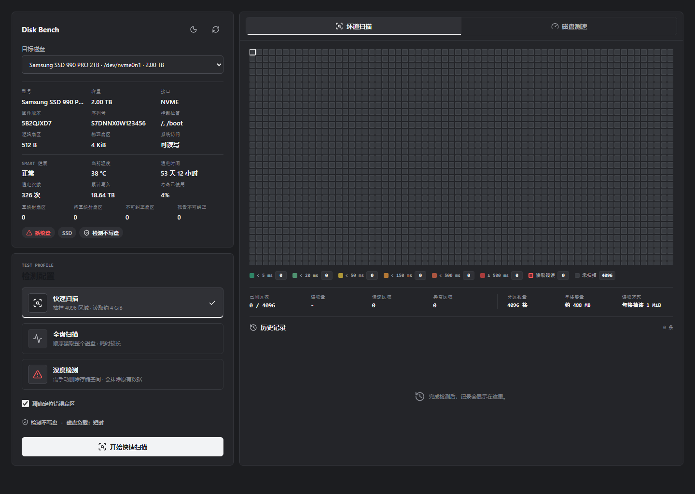

# Disk Bench

Disk Bench 是为飞牛 fnOS 设计的硬盘健康检测与性能测试工具。它把 SMART 信息、坏道扫描、
顺序与随机读写测速集中在一个界面中，适用于机械硬盘、SATA SSD、NVMe SSD、外接硬盘以及
由 RAID、Btrfs 或 ZFS 提供的存储空间。



## 主要功能

- 显示型号、容量、接口、固件、序列号、挂载位置和扇区大小等磁盘信息。
- 读取 SMART 健康、温度、通电时间、寿命及坏道相关计数；缺失字段统一显示为 `0` 或 `-`。
- 点击磁盘详情中的“SMART 信息”，弹窗查看所选物理盘的原始 smartctl 文本，支持刷新。读取已有信息和日志，不启动自检；休眠盘保留休眠状态，演示环境明确标注模拟数据。
- 快速扫描把整盘划分为 4096 个区域，每格在前、后半区各分散抽读 512 KiB，总读取量约 4 GiB，并覆盖盘头、盘尾。新扫描改变抽样位置，续扫保留原抽样方案和位置；小于 1 MiB 的区域完整读取。旧记录续扫沿用原居中抽样方案。
- 全盘扫描顺序读取整个设备，并以 4096 格块图显示响应时间和读取错误。扫描方式仅保留快速扫描和全盘扫描，均可选择按读取耗时阈值修复慢扇区。
- 手动停止或服务重启中断后，再次选择同一块硬盘会询问继续扫描、从头扫描或暂不扫描。续扫核对序列号、型号、容量和扇区信息，沿用原扫描参数并继承已完成区域及完整异常明细；中断时未完成的当前区域重新检测，原历史记录保留。扫描进度每 5 秒尝试保存，突发断电从最后成功保存的位置恢复；存在未确定的写回记录或异常日志不完整时不提供续扫。
- 块图按优秀、良好、正常、一般、较差、严重、损坏记录结果；界面将严重与损坏合并为“严重”，使用损坏色块，悬停可查看各自数量。只读扫描同时判断传输折算耗时与单次请求延迟，取较严重结果，读取错误优先。传输仍按 1 MiB 折算（不足 1 MiB 按 1 MiB），显示分档为 <5、5–<20、20–<50、50–<150、150–<500、≥500 ms；单次主机读取请求不超过 128 KiB，SSD/NVMe 等非机械设备 ≥20 ms 一般、≥50 ms 较差、≥100 ms 严重，HDD 则为 ≥50、≥150、≥500 ms。请求计时包含驱动与调度等待，不代表纯固件服务时间；NVMe 还可能按 MDTS 拆分。阈值是本项目的响应告警策略，不代表坏块结论。详情保留最慢请求耗时、长度、LBA 和折算耗时，后续快速读取不覆盖已记录的异常。旧历史保留原判定。
- 深度检测已停用，界面与接口不再新建整盘覆写校验任务；历史弹窗仍可加载已有深度检测记录，并查看原有写入、读回和校验结果。
- 可在发现读取异常后继续定位到逻辑扇区，并查看容量范围、LBA、响应时间和实际读取位置。
- 新的只读扫描分别统计持续不可读范围、复读恢复／固件纠正告警和设备异常；首次异常继续保留。普通 EIO 只能说明读取失败，不能单独证明物理介质损坏，显示格内出现异常也不代表整格扇区均已损坏。
- 完整只读扫描异常地址保存为本地日志，界面摘要最多 200 条，完整明细按页查看并可导出含磁盘身份、逻辑扇区大小、扫描参数和所有已保存异常的 JSON 报告。保存失败会停止扫描并标记记录不完整；旧历史保留原有结论，不能据此恢复曾被截断的地址。
- 只读扫描单次主机请求等待期限为 90 秒，超过后停止提交新读取，不在原请求仍运行时发起重试。取消会立即反馈停止请求，任务保持占用直到底层读取和句柄关闭真正完成；设备异常中止后的剩余地址保持未测。协议命令的 60 秒超时仍由内核处理，应用等待期限不能保证立即终止内核 I/O。
- 扫描详情显示“已完成读取判定覆盖”与“实际完整读出”占整盘的比例；前者包含已经定位的失败范围，后者只计入读出的数据。达到定位预算的待细查字节单独统计，不计入已确认覆盖率。快速抽样计划完成不代表整盘检测完成，复测传输量不重复增加覆盖率。
- Linux HDD 只读扫描优先使用 SCSI READ(16)，单个协议请求不超过 128 KiB，支持超过 2 TiB 的地址，并解析固定／描述符格式的 sense、主机及驱动状态。设备明确不支持该命令时回退到 `O_DIRECT`，在详情中说明无法细分协议错误；其他设备继续使用 `O_DIRECT`。不降级为系统缓存读取。全盘连续覆盖整个设备（含尾部），快速扫描仍为抽样。
- HDD 将介质错误与超时、连接、硬件／控制器错误分开记录。介质或未细分的 I/O 错误逐级缩小复读；连接／命令异常最多重试一次，仍失败就停止扫描，不把后续区域标成坏道。有效且属于当前请求范围的设备 LBA 仅作为线索，实际定位以复读结果为准。固件已纠正错误及复读恢复也保留首次记录。协议请求设置 60 秒超时，驱动错误恢复可能延长实际等待。
- 原生 NVMe 命名空间使用 Linux NVMe READ 透传，从内核取得实际 NSID，并核对容量、逻辑扇区及活动 LBA 格式；按控制器 MDTS 限制拆分请求，保留 64 位 LBA 和原生 SCT／SC／DNR。介质与数据完整性错误进入细分定位；控制器、路径、权限和未分配／未写入区域分别记录，不将其一律称为物理坏块。DNR 请求不在最小定位单位继续重试。NVMe 不使用 HDD 相对耗时基准。
- NVMe 历史错误／自检日志只显示与实际 NSID 匹配、地址有效且未越界的 LBA 线索；控制器级计数不等于该命名空间已确认的坏块。USB NVMe 桥接盘、不可访问透传接口或启用元数据／保护信息的格式使用内核 `O_DIRECT` 路径，并说明限制。读取成功、TRIM 返回的零数据不能证明全部物理 NAND 正常。
- NVMe 只读扫描可勾选“固件自检”，默认关闭。先确认 Identify OACS 支持扩展自检及当前没有其他自检，再启动；跟踪进度、核对本次新结果后继续读取扫描。不会把上次成功记录当成本次通过，也不会中止启动前已有的其他自检。用户取消或流程失败时仅尝试中止本次成功下发的自检；断连或进程退出时设备可能继续运行，需重查设备日志。演示模式不执行固件自检。无需新增 nvme-cli 依赖。
- HDD 额外参考最近最多 128 次同长度成功读取的中位耗时，至少 16 个样本后启用：3 倍标记偏慢，10 倍标记严重；整次读取等待达到 500 ms 也触发慢读检查。正常的 8 MiB／84 ms 读取若各小请求正常，不会被判成慢块；慢响应本身不能证明坏道。
- 快速和全盘扫描默认只读，折算耗时达到 50 ms/MiB（不足 1 MiB 按 1 MiB）、单次请求达到对应设备偏慢阈值，或触发 HDD 相对异常时，只读复测慢请求及前后各 128 KiB，合并重叠范围。复测也检查单次请求，保留首次慢响应和最差结果。Linux 记录并发读写及在途请求作为耗时参考；复测前最多等待 2 秒争取空闲，不能据此证明慢响应由负载造成。
- 读取失败范围逐级细分到所选精度。选择快速扫描时默认标准定位，全盘扫描时默认深入定位，也可手动调整；续扫沿用原记录的定位设置。标准定位每个失败读取范围最多提交 256 次定位请求，提交窗口 15 秒；深入定位增加到 4096 次／2 分钟。达到限额后保存待细查范围并继续后续扫描，不将未定位字节判为持续不可读。已提交的内核读取仍需等待设备返回或现有读取等待期限，定位预算不能立即中断它。复测传输量不重复计入扫描覆盖量。
- 可选“修复慢扇区（写回原数据）”，默认关闭。设置单次读取阈值（默认 500 ms，可设 1～60000 ms），仅处理超过阈值且完整读出的请求范围（最多 128 KiB）。复读一致后先持久保存原始数据和写入记录，再原址写回、刷新设备并读回比对；备份失败、短写入、刷新或校验失败会停止，不覆盖读不出的范围。原始数据存放在应用数据目录 `repair-backups/<任务ID>/`，文件名为字节偏移和长度，`metadata.json` 保存磁盘身份；删除历史或卸载删除历史不会删除这些备份。记录包含首次/写回后耗时、校验结论及备份文件名，可分页查看和导出。首次慢响应保持不变，校验通过不表示物理损伤已经修复，复测还可能受设备缓存影响。
- 扫描前后读取 SMART 与设备现有错误／自检日志，单独显示历史告警、可解析的 ATA LBA 线索和计数变化。日志线索不是本次确认的坏道，USB 桥接或部分设备可能不提供日志；未取得信息不会视为健康。固件缓存、已重映射物理扇区和写入可靠性不属于只读扫描能够完全验证的范围。
- 提供 CrystalDiskMark 风格的 `SEQ1M`、`RND4K` 读/写/混合测试，同时显示 MB/s 与 IOPS。
- 有存储空间或可识别挂载点时使用临时文件测速；空盘或无法识别文件系统时可使用底层测速。
- 识别 RAID、Btrfs、ZFS 及外接挂载，文件测速结果代表对应逻辑存储空间的整体性能。
- 扫描与测速历史分别保存，切换硬盘不会隐藏其他硬盘的历史记录。
- 支持浅色与深色主题，默认跟随 fnOS/浏览器的系统主题。
- 发布包内置对应架构的 `fio` 与 `smartctl`，无需额外安装运行依赖。

所有检测数据只保存在本机，应用不会把磁盘信息或测试结果上传到外部服务。

## 兼容性

| 项目 | 要求 |
| --- | --- |
| 系统 | fnOS `1.1.3100` 或更高版本 |
| 权限 | 仅管理员可打开；后台以 root 读取块设备 |
| x86 设备 | 选择文件名包含 `x86_64` 的 FPK |
| ARM 设备 | 选择文件名包含 `arm64` 或 `aarch64` 的 FPK |

不确定设备架构时，可在 SSH 终端运行：

```bash
uname -m
```

输出 `x86_64` 时安装 x86 包；输出 `aarch64` 或 `arm64` 时安装 ARM 包。

## 安装说明

1. 下载与设备 CPU 架构匹配的 `.fpk` 安装包。
2. 登录 fnOS 管理界面，打开“应用中心”。
3. 选择“手动安装”，上传 `.fpk` 文件。
4. 核对应用名称为 **Disk Bench**、开发者为 **情深深雨蒙蒙**，确认权限后完成安装。
5. 从 fnOS 桌面打开 Disk Bench，等待磁盘与 SMART 信息加载完成。

安装完成后不需要配置端口、Docker 或额外软件。若机械硬盘处于休眠状态，首次读取 SMART
或开始扫描时可能需要等待硬盘完成唤醒。

### 升级与旧版迁移

- 后续 `Disk Bench` 版本使用相同的应用 ID `diskbench`，可通过对应架构的升级包更新。
- 旧名称 `FN Smart`、`FN Drive Lab` 或应用 ID `fn-diskscan` 与当前应用 ID 不同，fnOS 会将
  Disk Bench 识别为新应用，不能直接覆盖升级。
- 旧应用的历史记录不会自动迁移。确认不再需要旧记录后，再手动卸载旧应用。
- 更新或卸载前请先停止正在运行的扫描与测速任务。

### 卸载与历史保留

- 在 fnOS 应用中心卸载时，可选择“保留记录”或“删除记录”，默认保留。
- fnOS 卸载时默认保留 `var` 和 `shares`，清理 `target`、`tmp`、`home`、`etc`。
  本项目历史已存放在 `TRIM_PKGVAR/jobs`（存储空间的 `@appdata/diskbench/jobs`），
  因此选择保留时直接保留原文件，无需另存备份或额外声明共享目录。
- 保留范围包含扫描、深度检测与测速历史，以及完整异常地址日志。卸载会先停止应用服务并保存任务中断状态；
  若仍在等待磁盘 I/O 或固件自检中止，停止卸载并提示稍后重试。
- 将相同应用 ID `diskbench` 重新安装到**原存储空间**后，后台直接读取原历史，无需恢复步骤。
- 选择删除时，仅在 `cmd/uninstall_callback` 清理本应用的历史与完整异常日志，无法恢复。
  若使用过 0.1.10，也会清理该版本生成的额外历史副本；不会删除磁盘上的个人文件。
- 命令行卸载未提供向导选项时默认保留。旧应用 ID `fn-diskscan` 的记录不属于此流程。

开发文档依据见 [fnOS 卸载目录规则](docs/fnos-lifecycle.md)。

## 使用说明

### 坏道扫描

1. 在左上角选择目标硬盘。
2. 选择“快速扫描”或“全盘扫描”。
3. 根据需要开启“精确定位错误扇区”，然后开始扫描。
4. 点击块图中的区域可查看容量范围、LBA、最大/平均响应和读取错误。

原生 NVMe 磁盘在扫描方式下方显示“NVMe 固件自检（可选）”复选框，默认不勾选。
勾选后点击“开始快速扫描”或“开始全盘扫描”，先执行固件扩展自检，结束后继续读取扫描。
它没有单独的启动按钮；测速和演示模式不执行该自检，非原生 NVMe 磁盘不显示此选项。

快速扫描适合日常巡检；全盘扫描会读取整块硬盘，耗时取决于硬盘容量和实际读速。块图中的
慢速区域表示响应时间偏高，不等同于坏道；应结合读取错误和 SMART 计数综合判断。

### 磁盘测速

1. 切换到“磁盘测速”，选择存储空间、外接挂载或允许底层测速的空盘。
2. 设置测试次数、样本大小、测试组合、队列深度和并发任务。
3. 可运行全部项目，也可单独点击 `SEQ1M` 或 `RND4K` 项目。
4. 测试完成后查看 MB/s、IOPS 及历史记录。

文件测速会在目标存储空间创建临时文件，并在任务结束后删除。RAID、Btrfs 或 ZFS 的测试结果
反映逻辑存储空间的整体性能，不代表其中某一块成员盘的独立性能。

## 重要安全说明

- 快速扫描和全盘扫描默认只读取磁盘。启用慢扇区修复时会实际写回原数据，开始前须输入 `REPAIR` 并确认已完成独立备份；系统盘、挂载盘、只读盘及阵列/ZFS/LVM/加密/交换成员盘禁止启用。Linux 使用独占的直接读写句柄，无法独占时停止。断电或写入失败仍可能损坏数据；取消和超时不能保证内核写入立即终止，任务会等待设备操作结束。
- 文件系统测速包含写入项目，会创建临时测试文件并占用存储空间；测试期间不要关机或拔盘。
- 没有可识别文件系统或存储空间的硬盘会使用底层测速。底层“写入”和“混合”项目会直接覆写
  原始块设备，永久破坏原有分区与数据，开始前必须输入 `ERASE` 二次确认。
- 系统盘、已挂载磁盘及已识别存储空间的成员盘不会开放破坏性底层写入。
- 检测结果只能反映当前状态，不能替代数据备份，也不能保证硬盘未来不会发生故障。

建议在 NAS 低负载时段运行测试。重要数据至少保留一份独立备份，出现读取错误或 SMART
坏道计数持续增长时，应尽快更换硬盘。

## 开发与测试

本地构建需要 Node.js 22 和 Go 1.22+：

```bash
npm install
npm test
npm run build
```

Windows 没有 Linux 块设备，可使用模拟数据预览界面：

```bash
npm run demo
```

然后访问 `http://127.0.0.1:5050/app/diskbench/`。真实磁盘扫描和测速需要在 Debian 或 fnOS
环境验证。本地预览通过 `LOCAL_DEV=1` 绕过 fnOS 网关管理员 Header，仅监听回环地址，不能
用于生产环境。

## 构建 FPK

项目会优先使用 `.tools/fnpack`，也可以通过 `FNPACK` 环境变量指定 fnpack。分别构建两种架构：

```bash
npm run fpk:amd64
npm run fpk:arm64
```

构建脚本会完成以下工作：

1. 生成桌面和应用中心图标。
2. 构建 React 前端。
3. 交叉编译对应架构的 Go 后端。
4. 装配对应架构的 `fio`、`smartctl` 及运行库。
5. 将 `manifest` 的平台字段更新为 `x86` 或 `arm`，再生成 FPK。

目标 fnOS 仍需提供基础系统命令：

```bash
command -v lsblk findmnt dd
```

## 项目结构

```text
backend/                    Go 后端、磁盘任务与测试
frontend/                   React + Vite 前端
package/diskbench/          fnOS FPK 打包目录
runtime-deps/               x86_64 / ARM64 内置运行依赖
scripts/                    构建、图标和装配脚本
```

后端使用 Go 标准库实现并编译为静态二进制，应用运行时不需要 Node.js。

## 开发者

- 开发者与发布者：情深深雨蒙蒙
- 主页：https://club.fnnas.com/home.php?mod=space&uid=1401&do=profile&from=space
